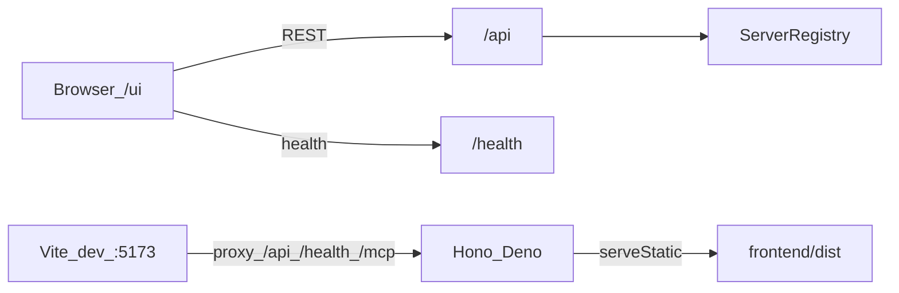

# Vue 3 + Naive UI Admin Frontend

## Context

Today the admin UI is one ~1700-line HTML/JS string in `[src/admin/ui.ts](src/admin/ui.ts)`, served by Hono at `/ui` (`[src/main.ts](src/main.ts)`). The REST contract in `[src/admin/api.ts](src/admin/api.ts)` stays unchanged. Scaffold intent (from `[.cursor/plans/mcp_host_scaffold_cb9c392d.plan.md](.cursor/plans/mcp_host_scaffold_cb9c392d.plan.md)`): Deno host + admin UI for MCP server lifecycle — this plan upgrades only the UI layer.

## Architecture




**Chosen stack (locked):**

- Vue 3 + TypeScript + Vite under `[frontend/](frontend/)`
- Naive UI + `@vicons/ionicons5` + Vue Router (history base `/ui/`)
- Shared state via Pinia (servers list, polling, settings)
- Tooling via Deno (`deno install`, `deno task …`) — no separate Node workflow for the app
- Gateway URL from `GET /health` → `gateway` (supports `GATEWAY_PUBLIC_URL`); no HTML template injection

## Serving & Docker

1. Replace `renderAdminUi` routes in `[src/main.ts](src/main.ts)` with Hono `serveStatic` from `frontend/dist`, SPA fallback to `index.html` for `/ui` and `/ui/*`.
2. Delete `[src/admin/ui.ts](src/admin/ui.ts)` once the Vue app has parity.
3. Root `[deno.json](deno.json)` tasks:
  - `ui:dev` — Vite with proxy to `:8080`
  - `ui:build` — Vite production build
  - `dev` — API watch + note/proxy (or parallel `dev:api` + `ui:dev`)
  - `start` — serve built assets (require `ui:build` first / Docker does it)
4. Dockerfile: add a frontend build stage; copy `frontend/dist` into the production image before `CMD`.

Vite config essentials: `base: '/ui/'`, `outDir: 'dist'`, dev proxy for `/api`, `/health`, `/mcp`.

## App structure

```
frontend/
  index.html
  package.json          # Vite/Vue/Naive deps (Deno-managed)
  vite.config.ts
  src/
    main.ts             # createApp + naive + router + pinia
    App.vue             # n-config-provider, n-message/dialog/notification providers
    theme.ts            # light/dark themeOverrides (forest teal accent)
    api/client.ts       # typed fetch wrapper (port of api())
    stores/servers.ts   # list + 4s poll
    stores/theme.ts     # light | dark | system
    router/index.ts
    layouts/AppLayout.vue
    views/
      ServersView.vue
      ServerDetailView.vue
      StoreView.vue
      ConnectView.vue
      ApiLabView.vue
      SettingsView.vue
    components/
      GatewayPill.vue
      StatusTag.vue
      AddServerModal.vue
      EnvKeyValueEditor.vue
      LogViewer.vue
      ToolList.vue
    data/templates.ts   # TEMPLATES + STORE + buildPayload
```

Routes (history, base `/ui/`):


| Path           | View     | Behavior to preserve                                      |
| -------------- | -------- | --------------------------------------------------------- |
| `/`            | Servers  | cards/list, status, start/stop/restart, tool counts, poll |
| `/servers/:id` | Detail   | edit form, logs poll, tools, per-server MCP URL           |
| `/store`       | Store    | preset catalog → open Add modal prefilled                 |
| `/connect`     | Connect  | client snippets + copy                                    |
| `/api`         | API lab  | endpoint table + request runner                           |
| `/settings`    | Settings | host settings + `/health` runtime                         |


## UX / theming (Naive-first, modern ops UI)

**Shell:** `n-layout` with collapsible sider (desktop) + drawer menu (mobile), sticky header with brand **MCP Hoster**, gateway pill + copy, primary “Add server”, theme toggle.

**Visual system:**

- Naive `themeOverrides` — accent around current green (`#0b6e4f` family), restrained neutrals, no purple-glow AI default look
- Light + dark themes; default follows `prefers-color-scheme`, persisted in `localStorage`
- Typography: load a distinctive pair (e.g. **DM Sans** + **IBM Plex Mono** for code/logs) via Google Fonts; wire into Naive `fontFamily` / `fontFamilyMono`
- Soft page background (subtle gradient) behind content; content uses Naive surfaces (`n-card` only where they group interactive server/ops content — this is an admin app)

**Component mapping:**

- Status → `n-tag` / custom `StatusTag` (`running` success, `error` error, transitional warning)
- Lifecycle → button groups + `n-popconfirm` for delete (replace `confirm`/`alert`)
- Feedback → `useMessage` / `useNotification`
- Forms → `n-form` + `n-dynamic-input` for env rows; launcher templates as `n-tabs` or segmented control inside `n-modal` / `n-drawer`
- Logs → monospace `n-log` or scrollable `n-code` with auto-tail
- API lab → `n-data-table` + `n-input` body + response panel
- Empty/loading → `n-empty` / `n-skeleton` on first load

**Interaction polish:**

- Keep 4s polling on servers list and detail logs (no new realtime API)
- Optimistic disable on lifecycle buttons while request in flight
- Copy-to-clipboard with brief “Copied” message
- Responsive: sider collapses; server cards become single column

## Implementation order

1. Scaffold `frontend/` (Vue-TS Vite), add Naive UI + router + pinia, wire Deno tasks and Vite proxy/`base`.
2. Theme provider + `AppLayout` shell + router stubs.
3. Port `api/client.ts`, types aligned with `[src/db/types.ts](src/db/types.ts)`, Pinia servers store + poll.
4. Implement Servers + AddServerModal (+ templates/store presets) for core workflow.
5. Server detail (edit, logs, tools), then Store, Connect, Api lab, Settings.
6. Switch Hono to static serve; remove `ui.ts`; update Dockerfile + README dev instructions (`deno task ui:dev` alongside API).

## Out of scope

- Auth, WebSocket/SSE live updates, API changes, Postgres, Go rewrite
- Reworking MCP gateway behavior

